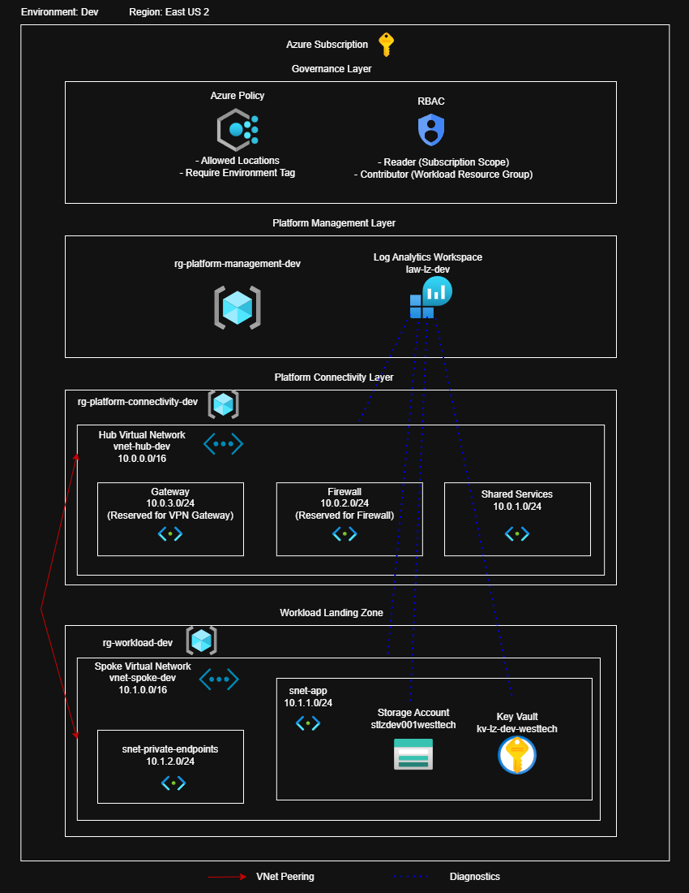

# Azure Enterprise Landing Zone with Terraform

A modular Azure infrastructure project demonstrating hub-and-spoke networking, Infrastructure as Code (IaC), governance, RBAC, and centralized logging. Built with Terraform to establish a repeatable foundation for enterprise workloads.

> **Scope:** The repository deploys a hub VNet, one **development** spoke VNet, bidirectional peering, Log Analytics, Azure Policy assignments, RBAC assignments, Storage, and Key Vault. It **does not** currently deploy Azure Firewall, Azure Bastion, NSGs, UDRs, or a production spoke. These are discussed as production-hardening steps, not implemented controls.

## 1. What problem does this solve?

Organizations often grow their cloud environments without consistent network boundaries, access controls, or deployment standards. This creates duplicated infrastructure, limited visibility, and risks such as development systems reaching production resources unintentionally.

This project uses Terraform to build a reusable Azure landing-zone foundation. The hub-and-spoke model separates shared platform connectivity from application networks, while Azure Policy and RBAC establish baseline governance. Infrastructure changes can be reviewed, versioned, and reproduced rather than configured manually.

## 2. Architecture

### Deployed components

| Component | Responsibility |
| --- | --- |
| **Hub VNet** (`10.0.0.0/16`) | Central network for shared connectivity; includes reserved firewall and gateway subnets. |
| **Dev spoke VNet** (`10.1.0.0/16`) | Isolates development address space and provides application/private-endpoint subnets. |
| **VNet peering** | Connects the hub and dev spoke privately in both directions. |
| **Log Analytics** | Creates a central workspace for telemetry when resource diagnostics are connected. |
| **Azure Policy & RBAC** | Assigns allowed-region/tagging policies and scoped access roles. |
| **Storage & Key Vault** | Demonstrates workload-resource provisioning. |

The hub is intended to host shared services such as **Azure Firewall and Azure Bastion**. Monitoring can be centralized through Log Analytics without requiring the workspace to be physically located inside the hub VNet.

### Traffic inspection and spoke security

In a production-grade, multi-spoke design:

- **Azure Firewall** in the hub inspects traffic explicitly routed through it, including selected inter-spoke flows.
- **User-defined routes (UDRs)** steer traffic to the firewall; peering alone does not enforce inspection.
- **Network security groups (NSGs)** at each spoke subnet boundary restrict inbound and outbound connections.
- **Azure Bastion** provides administrative access to private VMs without exposing public IP addresses.
- **Diagnostic settings** send relevant security and infrastructure logs to central monitoring.

**Example risk:** If a development subnet has an overly permissive NSG rule or an incorrect route/firewall policy, a compromised dev workload might reach production endpoints, potentially enabling lateral movement or data exposure. Production designs should **deny dev-to-prod access by default**, allow narrowly scoped exceptions, and verify blocked and permitted traffic with effective routes, NSG rules, and connection tests.

**Current limitation:** This repository has only a dev spoke. The reserved `AzureFirewallSubnet` is not a deployed firewall, and the peering configuration does not guarantee traffic inspection or production isolation.

## 3. Design decisions and tradeoffs

| Decision | Reasoning and tradeoff |
| --- | --- |
| **Hub-and-spoke vs. flat VNet** | Separates shared connectivity and workload networks; introduces additional routing and peering complexity. |
| **Terraform modules** | Reusable, version-controlled infrastructure; requires careful module inputs, outputs, and dependencies. |
| **Bidirectional peering** | Enables private hub-to-spoke connectivity; does not automatically provide firewall enforcement or transit routing. |
| **Azure Policy** | Standardizes regions and environment tags; subscription-scoped policies can affect unrelated deployments. |
| **Azure RBAC** | Demonstrates scoped permissions; production environments should use purpose-built identities/groups and least privilege. |
| **Log Analytics** | Provides a shared logging destination; actual log ingestion requires diagnostic configuration. |
| **Remote Terraform state** | Supports consistent team workflows; the state backend must be provisioned and secured separately. |

These choices favor repeatability and a scalable platform structure over a minimal one-off network deployment.

## 4. Challenges, troubleshooting, and lessons

The repository contains the final configuration, not a record of specific failures encountered during development. The following are **validation scenarios**, not claims about past incidents.

| Scenario | Diagnosis and response |
| --- | --- |
| **Peering connected, traffic fails** | Check both peerings, address ranges, effective routes, and applicable security rules. |
| **Traffic bypasses inspection** | Use Network Watcher Next hop/effective routes; add firewall policies and UDRs, then test the actual path. |
| **Unexpected dev-to-prod reachability** | Inspect NSGs, firewall rules, and routes; apply default-deny rules and validate with connectivity tests. |
| **No logs in workspace** | Check diagnostic settings, collection configuration, and ingestion rather than assuming a workspace collects everything automatically. |
| **Terraform deployment denied** | Review Azure Policy effects, RBAC scope, Azure Activity Log, and backend permissions. |

**Core lesson:** A network topology provides structure, but security must be enforced and tested. A hub, spoke, and peering connection are not equivalent to inspected, isolated application environments.

**Next hardening milestone:** Add a production spoke, Azure Firewall, Bastion, NSGs, UDRs, private access controls, diagnostic integrations, and tests proving that unauthorized dev-to-prod connectivity is blocked.
